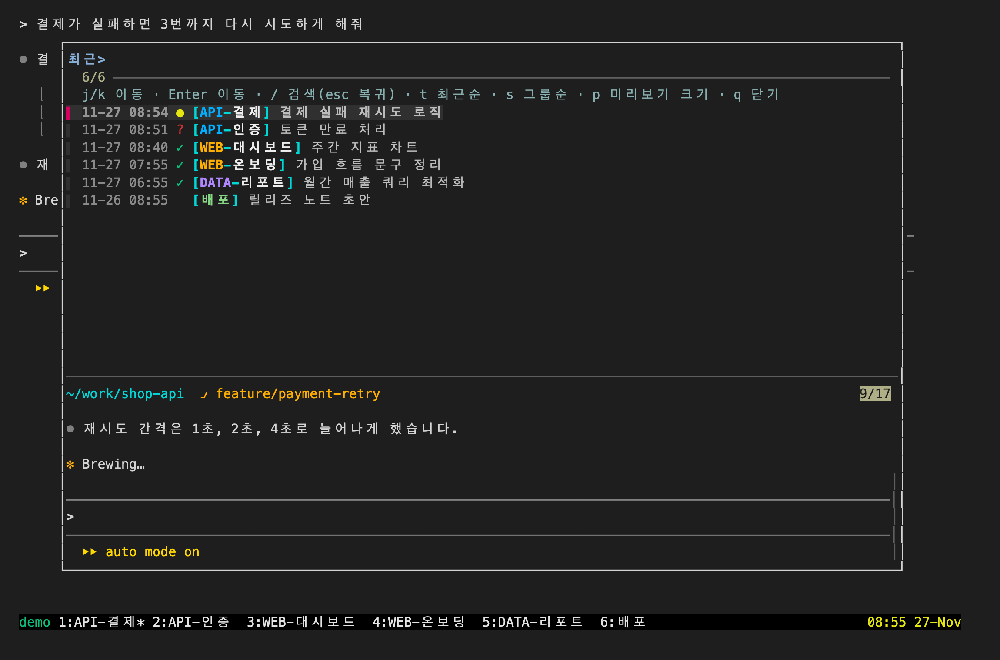
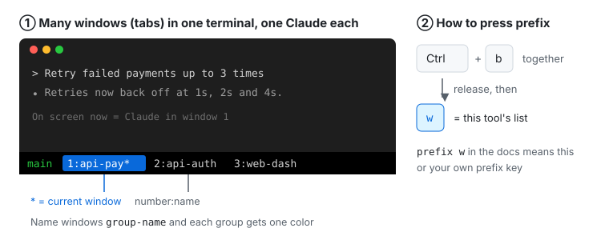
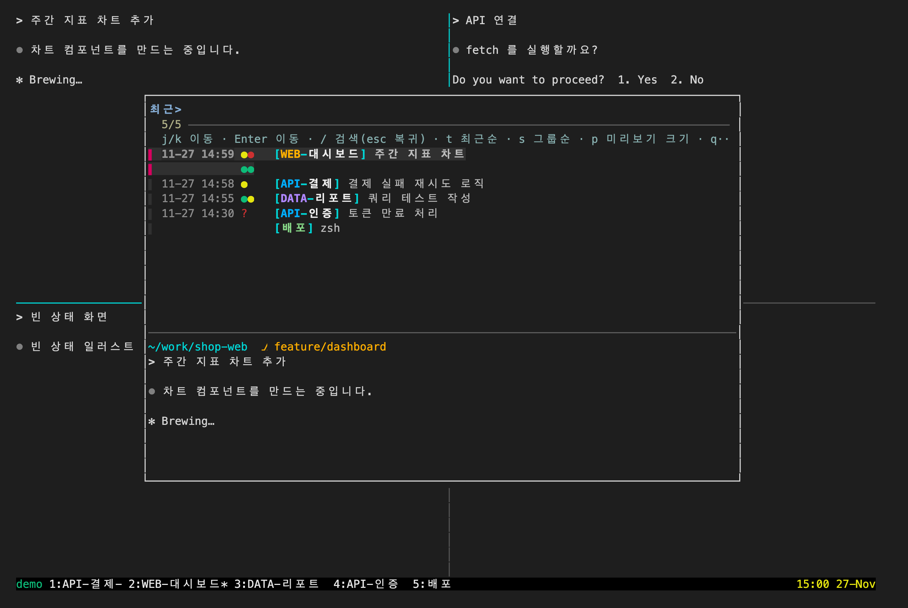

# tmux-cc-nav

[한국어](README.md) · **English**

When you run one Claude Code per tmux window, this shows which sessions are running, waiting for you, or done, right in the window list. Press `prefix w` to get a list with the most recently active session on top, and pick one to jump to its window.

> New to tmux? Start with [New to tmux](#new-to-tmux), which also explains what `prefix w` means.



`prefix w` opens a popup centered over the current screen. The top half is the session list; each row reads, left to right, last activity time, status, `[tmux window name]`, Claude session title. The bottom half previews the picked window, with its working folder and git branch on the first line. The windows and sessions in the pictures are made-up examples, and the UI text in them is Korean.

## New to tmux



tmux runs many windows (tabs) inside one terminal. The usual setup is one Claude Code per window; you can also split a window into panes and run several. Every tmux key is **prefix** (`Ctrl-b` by default), released, then the next key.

| To do | Key or command |
|---|---|
| Start tmux | `tmux` in a terminal |
| New window running Claude | `prefix c`, then `claude` in it |
| Rename a window | `prefix ,` then type e.g. `api-pay` |
| Go to another window | `prefix <number>`, or this tool's `prefix w` |
| Leave and come back | `prefix d` to detach, `tmux attach` to return. Claude keeps running meanwhile |

## Install

Needs tmux, fzf and python3. Built and checked on tmux 3.6 and fzf 0.75; older versions are not checked. The macOS input-source switch also needs the Xcode command line tools (`swiftc`).

```bash
brew install tmux fzf
git clone https://github.com/ach0o/tmux-cc-nav.git
cd tmux-cc-nav && ./install.sh
```

`install.sh` changes 3 places.

| Where | What changes |
|---|---|
| `~/.tmux/` | copies the scripts and `cc.tmux.conf` (overwritten; your settings live in `~/.tmux.conf`, so they stay) |
| `~/.tmux.conf` | appends one line, `source-file ~/.tmux/cc.tmux.conf` |
| `~/.claude/settings.json` | adds 5 hooks. Existing hooks stay; the original is backed up to `settings.json.bak-cc` |

Running it twice does not add the line or the hooks twice.

It overrides 2 tmux settings.
- `prefix w`: opens the fzf list instead of tmux's window list. The tmux list, with the same information, moves to `prefix W`. To use other keys, see Settings below.
- `mode-style`: the selected row in lists and copy mode turns grey, because status colors are unreadable on the default yellow. Set `@ccnav-mode-style` to `none` to keep your own.

Claude sessions already open before installing need a restart to get a status.

## Use

| Key | Action |
|---|---|
| `prefix w` | fzf list, most recent first, with a preview of the picked window below |
| `prefix W` | tmux's own list (`choose-tree`) with the same information |

Keys inside the `prefix w` list. It opens in move mode, so letters do not start a search.

| Key | Action |
|---|---|
| `j` / `k`, `g` / `G` | down / up, first / last |
| `Enter` | go to the picked window |
| `t` / `s` | sort by recent activity / by window name group |
| `p` | preview size 40% → 70% → hidden |
| `/` | search mode. `Esc` returns to move mode |
| `q` | close |

## Reading the list

| Mark | Meaning |
|---|---|
| yellow `●` | running: prompt sent, answer not finished |
| red `?` | waiting for you: a permission check or a question |
| green `✓` | done. A session stopped with Esc is corrected to done when the list opens |
| several colored circles | several Claudes in one window, in on-screen pane order (top left → top right → bottom left → bottom right): yellow running, red waiting, green done. The status column grows and shrinks with the window that has the most Claudes |
| grey time, empty status | a window without Claude. The time is the window's last output; such windows sort last by recent activity |
| `[front-rest]` | the tmux window name you set. Names with the same part before `-` or `_` share a color |



Here one window runs several Claudes in panes. The `WEB-대시보드` window behind the popup is split in 4, and the 4 circles on the first row show their status from the top left. The title and preview come from the pane in that window that was active most recently.

The preview's working folder is where Claude is working now, not where it started. If the session moves into a worktree, the worktree path and its branch show.

## Settings

Put options in `~/.tmux.conf` **above** the `source-file ~/.tmux/cc.tmux.conf` line. Options you leave out use their defaults. Reinstalling keeps these settings.

```tmux
set -g @ccnav-key-popup C-j       # fzf list on prefix C-j
set -g @ccnav-ime on              # switch to an English layout on prefix (macOS)
source-file ~/.tmux/cc.tmux.conf
```

| Option | Default | Meaning |
|---|---|---|
| `@ccnav-key-popup` | `w` | prefix key for the fzf list |
| `@ccnav-key-tree` | `W` | prefix key for tmux's list (`choose-tree`) |
| `@ccnav-popup-size` | `90%` | fzf popup width and height |
| `@ccnav-preview` | `40%` | preview height (`p` cycles 70% and hidden) |
| `@ccnav-color-bracket` | `44` | color of `[ ]` and the separator (256-color number) |
| `@ccnav-color-name` | `255` | color of the rest of the window name |
| `@ccnav-color-title` | `250` | color of the Claude session title |
| `@ccnav-palette` | 32 colors | group color candidates, space-separated 256-color numbers |
| `@ccnav-mode-style` | `bg=colour238 fg=white` | selected row style. `none` leaves it alone |
| `@ccnav-ime` | `off` | `on` switches the input source to an English layout the moment you press prefix (macOS) |

`@ccnav-ime` is for non-Latin input sources: with Korean input on, the `w` of `prefix w` arrives as `ㅈ` and nothing happens. It keeps your current prefix key.

<details>
<summary>How it works</summary>

- **Status and time**: Claude Code hooks call `~/.tmux/cc-hook.sh`, which records `@ccp` (status), `@ccp_t` (time) and `@ccp_cwd` (working folder) on the pane Claude runs in. When the list opens, `~/.tmux/cc-sync.py` gathers them per window. With several Claudes in a window, the list shows the title, preview and folder of the most recently active pane, and picking the row jumps to that pane.
- **Interrupt correction**: stopping with Esc does not fire the `Stop` hook, so the same script matches the status to the `busy`/`idle` value in `~/.claude/sessions/*.json` when the list opens.
- **Group colors**: on window rename, `~/.tmux/cc-color.sh` picks a color per group and saves the pairs in `~/.tmux/cc-groups`. There are 32 colors, so past 32 groups colors repeat.
- **Input-source switch**: `~/.tmux/abc` is built from `abc.swift` and switches the macOS input source to your English layout (ABC, U.S. and so on).

</details>

## Tests

```bash
tests/run.sh
```

They run only against a temporary HOME and a separate tmux server, so your tmux and Claude settings are untouched. They cover install and uninstall, hook input, status correction, several panes in one window, window names with special characters, and options.

## Uninstall

```bash
cd tmux-cc-nav && ./uninstall.sh
```

`uninstall.sh` removes only what `install.sh` added.

| Where | What it removes |
|---|---|
| `~/.tmux/` | the `cc-*` files, `abc`, `abc.swift`, and the group color file `cc-groups` |
| `~/.tmux.conf` | the `source-file ~/.tmux/cc.tmux.conf` line |
| `~/.claude/settings.json` | only the hooks that call `cc-hook.sh`. The original is backed up to `settings.json.bak-cc-uninstall` |
| running tmux | `prefix w` back to tmux's window list; `prefix W` and the selected row style back to before |
