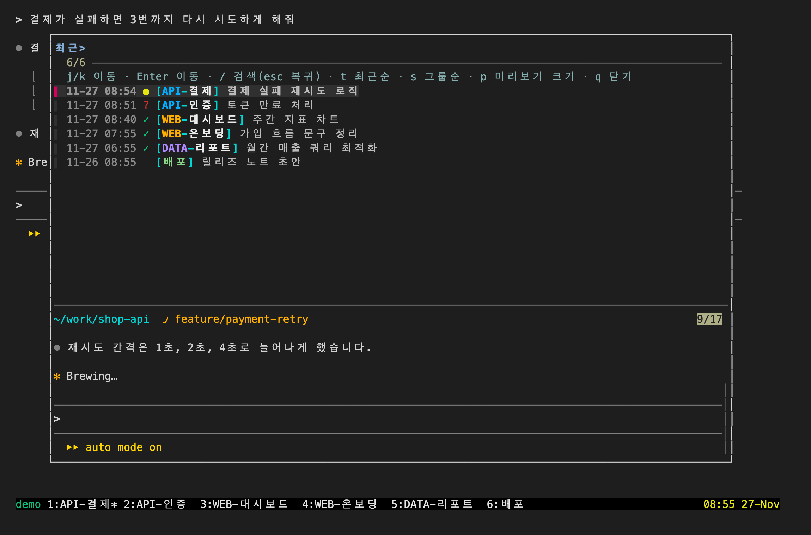

# claude-tmux-status

tmux 창마다 Claude Code를 하나씩 띄워 쓸 때, 어느 세션이 실행 중이고 어느 세션이 끝났는지 창 목록에서 한눈에 보게 해 줍니다. `prefix w`를 누르면 최근에 작업한 세션이 위로 오는 목록이 뜨고, 고르면 그 창으로 이동합니다.



`prefix w`를 누르면 지금 화면 위 가운데에 팝업이 뜹니다. 팝업 위쪽은 세션 목록이고, 한 줄은 왼쪽부터 마지막 작업 시각, 상태, `[tmux 창 이름]`, Claude 세션 제목 순서입니다. 아래는 고른 창의 미리보기로, 맨 윗줄에 작업 폴더와 git 브랜치가 나옵니다. 그림의 창과 세션은 설명용으로 만든 예시입니다.

## 설치

필요한 것: tmux, fzf, python3. tmux 3.6과 fzf 0.75에서 만들고 확인했습니다. 더 낮은 버전에서는 확인하지 않았습니다. macOS에서 한영 전환까지 쓰려면 Xcode 명령줄 도구(`swiftc`)도 필요합니다.

```bash
brew install fzf
./install.sh
```

`install.sh`가 하는 일은 3가지입니다.

| 대상 | 바뀌는 것 |
|---|---|
| `~/.tmux/` | 스크립트 6개와 `cc.tmux.conf`를 복사 |
| `~/.tmux.conf` | 끝에 `source-file ~/.tmux/cc.tmux.conf` 한 줄 추가 |
| `~/.claude/settings.json` | hook 5개 추가. 기존 hook은 그대로, 원본은 `settings.json.bak-cc`로 백업 |

두 번 실행해도 같은 줄이나 hook이 중복으로 들어가지 않습니다.

기존 tmux 설정 중 2가지를 덮어씁니다.
- `prefix w`: tmux 기본 창 목록 대신 fzf 목록이 뜹니다. 기본 목록은 `prefix W`에서 같은 정보와 함께 볼 수 있습니다.
- `mode-style`: 목록과 copy mode의 선택 줄 색이 회색이 됩니다. 기본 노랑 위에서는 상태 기호 색이 안 보이기 때문입니다. 원래 색을 쓰려면 `cc.tmux.conf`의 `mode-style` 줄을 지우세요.

설치 전에 이미 열려 있던 Claude 세션은 다시 시작해야 상태가 붙습니다.

## 쓰는 법

| 키 | 동작 |
|---|---|
| `prefix w` | fzf 목록. 최근 작업 순, 아래에 고른 창의 화면 미리보기 |
| `prefix W` | tmux 기본 목록(`choose-tree`)에 같은 정보 표시 |

`prefix w` 목록 안에서 쓰는 키입니다. 처음 열면 이동 모드입니다.

| 키 | 동작 |
|---|---|
| `j` / `k`, `g` / `G` | 위아래로 이동, 맨 위 / 맨 아래 |
| `Enter` | 고른 창으로 이동 |
| `t` / `s` | 최근 작업 순 / 창 이름 그룹 순으로 정렬 |
| `p` | 미리보기 크기 40% → 70% → 숨김 |
| `/` | 검색 모드. `Esc`로 이동 모드 복귀 |
| `q` | 닫기 |

## 화면 읽는 법

| 표시 | 뜻 |
|---|---|
| 노랑 `●` | 실행 중. 프롬프트를 보낸 뒤 답이 끝나기 전 |
| 빨강 `?` | 입력 대기. 권한 확인이나 질문 때문에 멈춤 |
| 초록 `✓` | 완료. Esc로 중단한 세션도 목록을 열 때 완료로 바로잡힘 |
| `[앞-뒤]` | 직접 붙인 tmux 창 이름. `-`나 `_` 앞부분이 같으면 같은 색 |

미리보기의 작업 폴더는 시작 폴더가 아니라 Claude가 지금 작업 중인 폴더입니다. 세션이 워크트리로 옮겨 가면 워크트리 경로와 그 브랜치가 나옵니다.

## 선택: prefix를 누르면 영문 입력으로 (macOS)

한글 입력 상태에서는 `prefix w`의 `w`가 `ㅈ`으로 들어가 동작하지 않습니다. `~/.tmux/cc.tmux.conf` 맨 끝의 주석 3줄을 풀면, prefix를 누르는 순간 입력기가 영문 자판으로 바뀝니다. 주석을 풀 때 `C-b`를 자기 prefix 키로 바꾸세요.

<details>
<summary>어떻게 동작하나</summary>

- **상태와 시각**: Claude Code hook이 `~/.tmux/cc-hook.sh`를 불러 tmux 창 옵션 `@cc`(상태), `@cc_t`(시각), `@cc_cwd`(작업 폴더)를 기록합니다.
- **중단 바로잡기**: Esc로 중단하면 `Stop` hook이 불리지 않습니다. 그래서 목록을 열 때 `~/.tmux/cc-sync.py`가 `~/.claude/sessions/*.json`의 `busy`/`idle` 값으로 상태를 맞춥니다.
- **그룹 색**: 창 이름을 바꿀 때 `~/.tmux/cc-color.sh`가 그룹마다 색을 정하고, 그 짝을 `~/.tmux/cc-groups`에 저장합니다. 색은 32개라서, 그룹이 32개를 넘으면 색이 겹칩니다.
- **한영 전환**: `~/.tmux/abc`는 `abc.swift`를 빌드한 프로그램으로, macOS 입력 소스를 그 사람의 영문 자판(ABC, U.S. 등)으로 바꿉니다.

</details>

## 지우기

1. `~/.tmux.conf`에서 `source-file ~/.tmux/cc.tmux.conf` 줄을 지웁니다.
2. `~/.claude/settings.json`에서 `~/.tmux/cc-hook.sh`를 부르는 hook 5개를 지웁니다.
3. `~/.tmux/`의 `cc-*` 파일들과 `abc`, `abc.swift`를 지웁니다.
