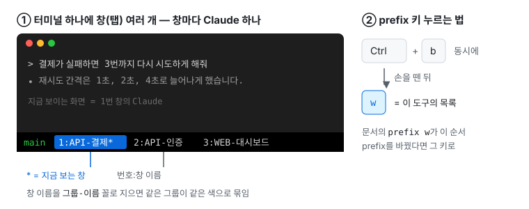
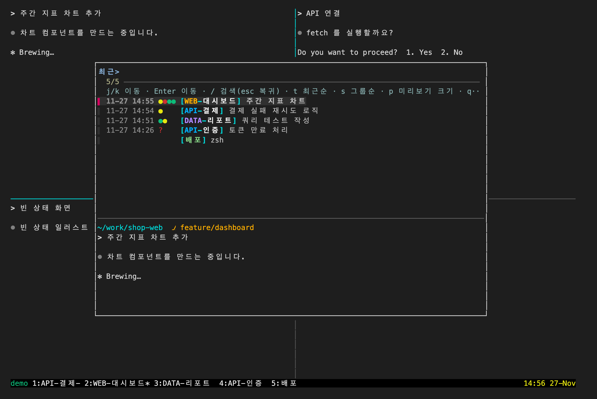

# tmux-cc-nav

tmux 창마다 Claude Code를 하나씩 띄워 쓸 때, 어느 세션이 실행 중이고 어느 세션이 끝났는지 창 목록에서 한눈에 보게 해 줍니다. `prefix w`를 누르면 최근에 작업한 세션이 위로 오는 목록이 뜨고, 고르면 그 창으로 이동합니다.

> tmux가 처음이면 [tmux가 처음이라면](#tmux가-처음이라면)을 먼저 보세요. `prefix w`가 무슨 뜻인지도 거기 있습니다.


`prefix w`를 누르면 지금 화면 위 가운데에 팝업이 뜹니다. 팝업 위쪽은 세션 목록이고, 한 줄은 왼쪽부터 마지막 작업 시각, 상태, `[tmux 창 이름]`, Claude 세션 제목 순서입니다. 아래는 고른 창의 미리보기로, 맨 윗줄에 작업 폴더와 git 브랜치가 나옵니다. 그림의 창과 세션은 설명용으로 만든 예시입니다.

## tmux가 처음이라면



tmux는 터미널 하나 안에 창(탭)을 여러 개 띄우는 도구입니다. 창마다 Claude Code를 하나씩 띄워 쓰는 것이 기본이고, 한 창을 pane으로 나눠 Claude를 여러 개 띄워도 됩니다. tmux 키는 모두 **prefix**(기본 `Ctrl-b`)를 먼저 누르고 손을 뗀 뒤 다음 키를 누릅니다.

| 할 일 | 키나 명령 |
|---|---|
| tmux 시작 | 터미널에서 `tmux` |
| 새 창을 만들고 Claude 띄우기 | `prefix c`, 그 창에서 `claude` |
| 창 이름 바꾸기 | `prefix ,` 후 `API-결제`처럼 입력 |
| 다른 창으로 가기 | `prefix 숫자`, 또는 이 도구의 `prefix w` |
| 나갔다가 다시 들어오기 | `prefix d`로 나가고 `tmux attach`로 복귀. 나가 있는 동안에도 Claude는 계속 돎 |

## 설치

필요한 것: tmux, fzf, python3. tmux 3.6과 fzf 0.75에서 만들고 확인했습니다. 더 낮은 버전에서는 확인하지 않았습니다. macOS에서 한영 전환까지 쓰려면 Xcode 명령줄 도구(`swiftc`)도 필요합니다.

```bash
brew install fzf
git clone https://github.com/ach0o/tmux-cc-nav.git
cd tmux-cc-nav && ./install.sh
```

`install.sh`가 하는 일은 3가지입니다.

| 대상 | 바뀌는 것 |
|---|---|
| `~/.tmux/` | 스크립트들과 `cc.tmux.conf`를 복사 (덮어씀. 설정은 `~/.tmux.conf`에 두므로 남음) |
| `~/.tmux.conf` | 끝에 `source-file ~/.tmux/cc.tmux.conf` 한 줄 추가 |
| `~/.claude/settings.json` | hook 5개 추가. 기존 hook은 그대로, 원본은 `settings.json.bak-cc`로 백업 |

두 번 실행해도 같은 줄이나 hook이 중복으로 들어가지 않습니다.

기존 tmux 설정 중 2가지를 덮어씁니다.
- `prefix w`: tmux 기본 창 목록 대신 fzf 목록이 뜹니다. 기본 목록은 `prefix W`에서 같은 정보와 함께 볼 수 있습니다. 다른 키를 쓰려면 아래 설정에서 바꾸세요.
- `mode-style`: 목록과 copy mode의 선택 줄 색이 회색이 됩니다. 기본 노랑 위에서는 상태 기호 색이 안 보이기 때문입니다. 원래 색을 쓰려면 아래 설정에서 `@ccnav-mode-style`을 `none`으로 두세요.

설치 전에 이미 열려 있던 Claude 세션은 다시 시작해야 상태가 붙습니다.

## 쓰는 법

| 키 | 동작 |
|---|---|
| `prefix w` | fzf 목록. 최근 작업 순, 아래에 고른 창의 화면 미리보기 |
| `prefix W` | tmux 기본 목록(`choose-tree`)에 같은 정보 표시 |

`prefix w` 목록 안에서 쓰는 키입니다. 처음 열면 이동 모드입니다.

| 키 | 동작 |
|---|---|
| `j` / `k`, `g` / `G` | 위아래로 이동, 맨 위 / 맨 아래 |
| `Enter` | 고른 창으로 이동 |
| `t` / `s` | 최근 작업 순 / 창 이름 그룹 순으로 정렬 |
| `p` | 미리보기 크기 40% → 70% → 숨김 |
| `/` | 검색 모드. `Esc`로 이동 모드 복귀 |
| `q` | 닫기 |

## 화면 읽는 법

| 표시 | 뜻 |
|---|---|
| 노랑 `●` | 실행 중. 프롬프트를 보낸 뒤 답이 끝나기 전 |
| 빨강 `?` | 입력 대기. 권한 확인이나 질문 때문에 멈춤 |
| 초록 `✓` | 완료. Esc로 중단한 세션도 목록을 열 때 완료로 바로잡힘 |
| 색 원 2~4개 | 한 창에 Claude가 여럿. pane 화면 위치 순서(왼쪽 위 → 오른쪽 위 → 왼쪽 아래 → 오른쪽 아래)로 노랑 실행중 · 빨강 입력대기 · 초록 완료 |



한 창을 pane으로 나눠 Claude를 여러 개 띄운 예입니다. 뒤 화면의 `WEB-대시보드` 창은 4칸으로 나뉘어 있고, 목록 첫 줄의 원 4개가 왼쪽 위부터 그 상태를 보여 줍니다. 제목과 미리보기는 그 창에서 가장 최근에 움직인 pane 것입니다.
| `[앞-뒤]` | 직접 붙인 tmux 창 이름. `-`나 `_` 앞부분이 같으면 같은 색 |

미리보기의 작업 폴더는 시작 폴더가 아니라 Claude가 지금 작업 중인 폴더입니다. 세션이 워크트리로 옮겨 가면 워크트리 경로와 그 브랜치가 나옵니다.

## 설정

`~/.tmux.conf`에서 `source-file ~/.tmux/cc.tmux.conf` 줄 **위에** 옵션을 적으면 됩니다. 적지 않은 옵션은 기본값을 씁니다. 다시 설치해도 이 설정은 그대로 남습니다.

```tmux
set -g @ccnav-key-popup C-j       # fzf 목록을 prefix C-j 로
set -g @ccnav-ime on              # prefix를 누르면 영문 입력으로 (macOS)
source-file ~/.tmux/cc.tmux.conf
```

| 옵션 | 기본값 | 뜻 |
|---|---|---|
| `@ccnav-key-popup` | `w` | fzf 목록을 여는 prefix 키 |
| `@ccnav-key-tree` | `W` | tmux 기본 목록(`choose-tree`)을 여는 prefix 키 |
| `@ccnav-popup-size` | `90%` | fzf 팝업 폭과 높이 |
| `@ccnav-preview` | `40%` | 미리보기 높이 (`p`로 70%, 숨김과 번갈아 바뀜) |
| `@ccnav-color-bracket` | `44` | `[ ]`와 구분자 색 (256색 번호) |
| `@ccnav-color-name` | `255` | 창 이름 뒷부분 색 |
| `@ccnav-color-title` | `250` | Claude 세션 제목 색 |
| `@ccnav-palette` | 32색 목록 | 그룹 색 후보, 공백으로 구분한 256색 번호 |
| `@ccnav-mode-style` | `bg=colour238 fg=white` | 선택 줄 색. `none`이면 건드리지 않음 |
| `@ccnav-ime` | `off` | `on`이면 prefix를 누르는 순간 입력기를 영문 자판으로 (macOS) |

`@ccnav-ime`은 한글 입력 상태에서 `prefix w`의 `w`가 `ㅈ`으로 들어가 동작하지 않는 문제를 막습니다. 지금 쓰는 prefix 키를 그대로 씁니다.

<details>
<summary>어떻게 동작하나</summary>

- **상태와 시각**: Claude Code hook이 `~/.tmux/cc-hook.sh`를 불러, Claude가 도는 pane에 `@ccp`(상태), `@ccp_t`(시각), `@ccp_cwd`(작업 폴더)를 기록합니다. 목록을 열 때 `~/.tmux/cc-sync.py`가 이를 창마다 모읍니다. 한 창에 Claude가 여럿이면 가장 최근에 움직인 pane의 제목, 미리보기, 폴더를 보여 주고, 고르면 그 pane으로 이동합니다.
- **중단 바로잡기**: Esc로 중단하면 `Stop` hook이 불리지 않습니다. 그래서 목록을 열 때 같은 스크립트가 `~/.claude/sessions/*.json`의 `busy`/`idle` 값으로 상태를 맞춥니다.
- **그룹 색**: 창 이름을 바꿀 때 `~/.tmux/cc-color.sh`가 그룹마다 색을 정하고, 그 짝을 `~/.tmux/cc-groups`에 저장합니다. 색은 32개라서, 그룹이 32개를 넘으면 색이 겹칩니다.
- **한영 전환**: `~/.tmux/abc`는 `abc.swift`를 빌드한 프로그램으로, macOS 입력 소스를 그 사람의 영문 자판(ABC, U.S. 등)으로 바꿉니다.

</details>

## 테스트

```bash
tests/run.sh
```

임시 HOME과 따로 띄운 tmux 서버에서만 돌기 때문에, 쓰고 있는 tmux와 Claude 설정은 건드리지 않습니다. 설치와 제거, hook 입력, 상태 바로잡기, 한 창의 여러 pane, 특수문자 창 이름, 설정 옵션을 확인합니다.

## 지우기

```bash
cd tmux-cc-nav && ./uninstall.sh
```

`uninstall.sh`는 `install.sh`가 넣은 것만 지웁니다.

| 대상 | 지우는 것 |
|---|---|
| `~/.tmux/` | `cc-*` 파일, `abc`, `abc.swift`, 그룹 색 파일 `cc-groups` |
| `~/.tmux.conf` | `source-file ~/.tmux/cc.tmux.conf` 줄 |
| `~/.claude/settings.json` | `cc-hook.sh`를 부르는 hook만. 원본은 `settings.json.bak-cc-uninstall`로 백업 |
| 실행 중인 tmux | `prefix w`를 기본 창 목록으로, `prefix W`와 선택 줄 색을 원래대로 |
